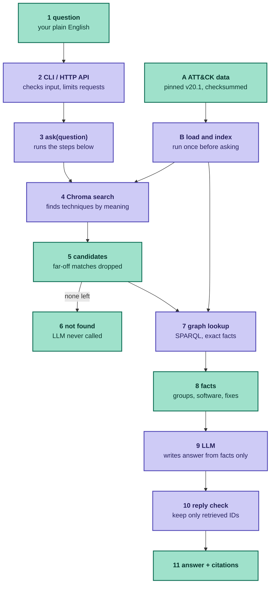

# attack-graph-rag

Ask plain-English questions about MITRE ATT&CK and get a short answer that cites the technique IDs it used, or an honest "not found".

## What it does (the two-minute version)

ATT&CK is a large public catalog of how attackers behave. It is searchable only by exact name or ID. A bare LLM is easier to ask but can invent techniques. This service combines three things so answers stay grounded:

1. **Vector search (Chroma)** finds techniques by _meaning_. "How do attackers get in through email?" finds Phishing without you knowing its name.
2. **Knowledge graph (RDF, queried with SPARQL)** supplies _exact_ facts for those techniques: which groups use them, which software, which mitigations.
3. **LLM** writes a short answer from only those retrieved facts. Any technique ID in the reply that was not retrieved is thrown away. If nothing relevant was found, the LLM is never called and the reply says so.

It runs as a CLI and an HTTP API, in plain Python, in Docker Compose, or on a local Kubernetes (kind) cluster. It is a learning and portfolio project, not a production service.

## Architecture

**Key:** teal boxes are data, purple boxes are code.



**Steps, in plain English** (numbers match the boxes):

1. **Question:** you type something like "how do attackers get in through email?".
2. **CLI / HTTP API:** the front door. Rejects empty or too-long questions, rate-limits, and always replies in the same `{success, data, error}` shape.
3. **ask(question):** the single function that runs steps 4 to 11. The CLI and API both call it.
4. **Chroma search:** Chroma is a vector database. Every technique was *embedded* earlier (turned into a list of numbers for its meaning, by the MiniLM model). Your question is embedded the same way, and Chroma returns the techniques with the closest numbers.
5. **Candidates:** the closest techniques. Any hit farther than cosine distance 0.75 is dropped as not relevant.
6. **Not found:** if no candidate is left, we stop and say so. The LLM is never called.
7. **Graph lookup:** for each candidate, a SPARQL query on the knowledge graph fetches exact facts.
8. **Facts:** which groups use the technique, which software, which mitigations, as plain text.
9. **LLM:** the model gets the question and only these facts, and writes a short answer. (`offline` mode skips the model and restates one fact.)
10. **Reply check:** keep only technique IDs we really retrieved. A reply with none, or one that leaks the system rules, becomes "not found".
11. **Answer + citations:** what you see.

**Setup, run once before asking:** **A** is MITRE's ATT&CK data file, pinned to v20.1 and checked by checksum. **B** `load` turns it into the graph (feeds step 7) and `index` embeds every technique into Chroma (feeds step 4).

Why two stores: Chroma handles vague questions (meaning); the graph handles exact ones ("what does APT29 use?").

Every component is behind a small interface and injected, so tests swap in an in-memory graph, a tiny fake embedder and a fake LLM. Reasons for each choice are in [docs/decisions.md](docs/decisions.md).

## Demo

Everything below was run for this README with the bundled 20-technique fixture and the **offline** answerer (`ATTACK_GRAPH_LLM=offline`), which needs no API key. The offline answerer only restates the first retrieved fact, so it shows the pipeline and the citation rules, **not the writing quality of a real model**. No real-LLM output is shown because none was run.

```bash
uv sync
export ATTACK_GRAPH_LLM=offline
uv run attack-graph index
```

```text
Indexed 20 techniques
```

Exact facts from the graph:

```bash
uv run attack-graph technique T1566.001
```

```text
T1566.001 Spearphishing Attachment
Tactics: initial-access
Targeted emails carry a malicious attachment that runs when opened.

Groups:
  G0007 APT28
  G0016 APT29
  G0046 FIN7
Software: none
Mitigations:
  M1017 User Training
```

Search by meaning, then ask:

```bash
uv run attack-graph search "how do attackers use email?" --limit 3
```

```text
T1566.001 Spearphishing Attachment
T1566 Phishing
T1078 Valid Accounts
```

```bash
uv run attack-graph ask "how do attackers get in through email?"
```

```text
Closest match: Phishing [T1566].

Cited:
  T1566 Phishing
Retrieved:
  T1566 Phishing
  T1566.001 Spearphishing Attachment
  T1078 Valid Accounts
  T1190 Exploit Public-Facing Application
  T1021 Remote Services
```

```bash
uv run attack-graph ask "what is the best pizza topping?"
```

```text
Not found in the ATT&CK data, so no answer was given.
```

The same through the HTTP API (`uv run attack-graph serve`, then in another terminal). Every reply is `{success, data, error}`:

```bash
curl -s localhost:8000/ask -d '{"question": ""}'
```

```text
{"success":false,"data":null,"error":{"code":"invalid_question","message":"The question is empty."}}
```

For real answers set `ANTHROPIC_API_KEY` (or point at a local model) and run `uv run attack-graph load` first to get all of ATT&CK Enterprise. See [docs/operations.md](docs/operations.md).

## Quick start

```bash
uv sync                                  # install
uv run pytest                            # fast tests, offline, no key
uv run attack-graph load                 # optional: full ATT&CK v20.1, ~55 MB download once
uv run attack-graph index                # embed techniques (~80 MB model, first run only)
uv run attack-graph ask "how do attackers get in through email?"
```

`ask` needs `ANTHROPIC_API_KEY`, or `ATTACK_GRAPH_LLM=offline` / `local`. Full run, Docker Compose, Kubernetes, configuration and troubleshooting: [docs/operations.md](docs/operations.md).

## Safety and testing in brief

- **Grounded:** only retrieved technique IDs count as citations; an uncited reply is discarded.
- **Prompt injection:** fixed rules in the system message, question and facts in escaped data blocks, leaked-rule replies withheld. This lowers risk and does not guarantee a real model obeys. Details and limits: [decisions](docs/decisions.md).
- **API:** body size limit, per-client rate limit, security headers, fixed error text, logs with no question text or keys.
- **Tests:** all through `ask(question)` with a fixture and a fake LLM. Quality is measured separately by an on-demand eval set against the real model (`uv run attack-graph eval`).
- **Security review:** [checklist review](docs/security/checklist-review.md) and [scan results](docs/security/scan-results.md), including accepted findings and open gaps.

## Verification status

Honest summary of what has and has not been run. The full table is in [docs/operations.md](docs/operations.md#verification-status).

- **Verified:** the offline test suite; the CLI and HTTP API in offline mode (the demo above); the Docker images and Compose stack (`scripts/compose-smoke.sh` passes all 5 checks, run 2026-11-24, after one fix: the Chroma data folder was not writable by the non-root user); the full v20.1 load, index, search and ask run natively against real Oxigraph and Chroma servers (per the issue #9 notes); source security scans.
- **Written but never run:** Kubernetes manifests (kind is not installed, so `scripts/k8s-smoke.sh` has not run) and the container image scan (trivy is not installed). Run `scripts/k8s-smoke.sh` and `scripts/security-scan.sh images` before relying on them.
- **Not run against a real model:** `ask` with Claude and the eval set. Eval expectations are untuned.

## Future improvements

- Run the unverified pieces and fix what they turn up (Docker, Kubernetes, image scan, real-model evals); tune eval expectations and the 0.75 "not relevant" distance.
- Better retrieval: on the full data Phishing is in the top 10 but not the top 5 for the email question. Try a larger embedding model or re-ranking using the graph.
- Swap Chroma for pgvector; the vector store is behind a two-method interface. This would also remove the Chroma server advisories (no fix exists yet).
- Add an LLM judge to the evals, with care for its own injection risk.
- Add CI to run tests and scans on every push.
- A simple web UI (clients must not render answers as HTML).
- Model tactics and sub-techniques as graph resources; OWL modeling.
- Service hardening: TLS and authentication in front of the API, a shared rate limiter that works behind a proxy, NetworkPolicy on a cluster that enforces it, image digests and a registry.
- Mobile and ICS matrices; conversation memory.

## Credit and licensing

This project uses the **MITRE ATT&CK®** Enterprise knowledge base (v20.1, STIX release from [mitre-attack/attack-stix-data](https://github.com/mitre-attack/attack-stix-data)). ATT&CK data is **not** part of this repository; `attack-graph load` downloads it. The tiny test fixture is hand-written, with IDs and names following ATT&CK.

MITRE's [Terms of Use](https://attack.mitre.org/resources/legal-and-branding/terms-of-use/) grant a non-exclusive, royalty-free license to use ATT&CK for research, development and commercial purposes, provided MITRE's copyright designation and the license are reproduced in any copy. Their notice reads:

> © 2026 The MITRE Corporation. This work is reproduced and distributed with the permission of The MITRE Corporation.

(Wording checked on the Terms of Use page on 2026-11-24; the year may change, so re-check when you update the data.) MITRE ATT&CK and ATT&CK are registered trademarks of The MITRE Corporation. This project is independent and is not endorsed by or affiliated with MITRE. ATT&CK is provided "as is" and does not claim to list every possible technique, so an answer here is not a guarantee of defensive coverage.

This repository does not yet include a license for its own code.
