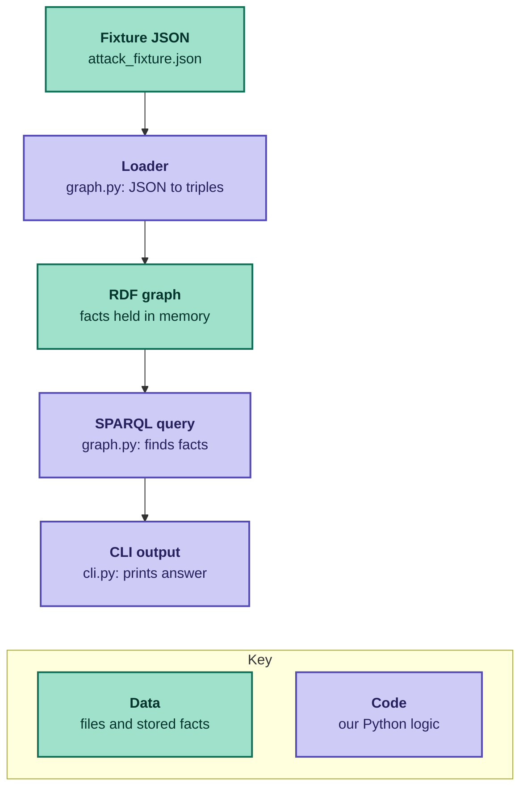

# Issue #2: fixture graph and lookup CLI

What was built: a small ATT&CK fixture is loaded into an in-memory graph, and a command-line tool looks up a technique or group and prints its facts.

Related: [glossary](glossary.md), [Python for Node/TS developers](python-for-node-devs.md).

## The big picture



Teal boxes hold data. Purple boxes are code we wrote.

1. The fixture is a JSON file in STIX format (MITRE's format for ATT&CK).
2. The loader reads it and turns each item into facts.
3. The facts live in an in-memory graph.
4. A lookup runs a SPARQL query against the graph.
5. The CLI formats the result and prints it.

Tests call the CLI's `main()` and check what it prints.

## Files and what they do

- `pyproject.toml`: project config.
- `uv.lock`: pinned versions.
- `src/attack_graph/graph.py`: loader, SPARQL queries, and data shapes.
- `src/attack_graph/cli.py`: argument parsing and printing.
- `src/attack_graph/data/attack_fixture.json`: the STIX test data.
- `tests/test_lookup_cli.py`: the tests.
- `CLAUDE.md`: instructions for the AI assistant, not part of the app.
- `docs/decisions.md`: why choices were made.

## graph.py tour

Read the file top to bottom alongside this.

### Imports and constants

- `AG = Namespace("https://attack-graph-rag.example/ns#")` is a prefix for our own vocabulary. `AG.name` becomes the full URL `https://attack-graph-rag.example/ns#name`. RDF names things with URLs so different vocabularies don't clash. The URL doesn't have to exist.
- `_STIX_KINDS` maps STIX object types (`attack-pattern`) to our classes (`AG.Technique`). Note: STIX calls a technique an "attack-pattern" and a group an "intrusion-set".
- `_RELATIONS` maps STIX relationship types (`uses`, `mitigates`) to predicates. Anything else is ignored.

### Data shapes

- `Ref` is a small pointer: an ID and a name, like `S0002 Mimikatz`.
- `Technique` and `Group` are the results a lookup returns. They are plain read-only records, like TS interfaces that also construct themselves.
- `DataFileError` is our own error type, so the CLI can catch "bad data file" without catching everything.

### `AttackGraph.from_stix_file`

1. Read the file and parse JSON. A missing or unreadable file raises `DataFileError`, and so do bad JSON or a missing `objects` key.
2. Make an empty `Graph()`.
3. First pass: `_add_object` for every object. It returns `True` if the object became part of the graph, and the loop remembers those STIX IDs in `known`.
4. Second pass: `_add_relationship` for every object. Relationships are added only when both ends are in `known`.

Two passes are needed because a relationship can appear in the file before the things it links.

### `_add_object`

- Skips types we don't model, and anything revoked or deprecated.
- Finds the ATT&CK ID (like `T1566`) in `external_references`.
- Makes a subject URL like `urn:stix:attack-pattern--...`. This identifies the thing inside the graph.
- Adds triples: its type, `attackId`, `name`, `description`, plus any `alias` and `tactic` values.

For one technique the graph holds roughly:

```
<technique>  type         Technique
<technique>  attackId     "T1566.001"
<technique>  name         "Spearphishing Attachment"
<technique>  tactic       "initial-access"
<group>      uses         <technique>
<mitigation> mitigates    <technique>
```

### `_add_relationship`

Adds one triple, `source - uses/mitigates - target`, like `APT29 uses T1566.001`.

### `AttackGraph.technique`

- Cleans the ID: `strip().upper()`, so `" t1566.001 "` works.
- Runs a SPARQL query. Read it as: "find an `?s` of type Technique whose `attackId` is `?id`, and give me its name and description."
- No match returns `None`.
- Then it fetches related things:
  - tactics, with one small query
  - groups, software, and mitigations, with `_refs`

### `AttackGraph.group`

- Lowercases the input with `casefold()` so matching ignores case.
- The query uses `(ag:name|ag:alias) ?label`, which means "name OR alias". `FILTER(LCASE(STR(?label)) = ?needle)` keeps the rows whose label matches.
- That is why `cozy bear` finds APT29.
- Aliases returned exclude the main name, since it's already shown.

### `_refs`

A helper that takes a pattern fragment and a subject, then returns sorted `Ref`s. The `?s` in the pattern is the thing we're looking up. Example: `?x a ag:Group ; ag:uses ?s` means "groups that use this technique".

### `_query` and `_first`

- `_query` runs SPARQL. Values go in through `initBindings`, never through string formatting. This is the same reason you use parameterized SQL: user input can never change the query's shape.
- `_first` returns the first result row or `None`.

## What to try

1. **Match output to code.** Run `uv run attack-graph technique T1003.001`. Then open `_format_technique` in `cli.py` and find the line of code that printed each line you see.

2. **Remove one fact and watch the output change.** A relationship is one fact linking two things, like "APT29 uses T1566.001". This makes a copy of the fixture without that one fact. Your real fixture is not touched.

   ```bash
   uv run python -c "
   import json
   from importlib.resources import files
   d = json.loads((files('attack_graph')/'data'/'attack_fixture.json').read_text())
   ids = {o['external_references'][0]['external_id']: o['id'] for o in d['objects'] if 'external_references' in o}
   d['objects'] = [o for o in d['objects'] if not (o.get('relationship_type') == 'uses' and o['source_ref'] == ids['G0016'] and o['target_ref'] == ids['T1566.001'])]
   json.dump(d, open('/tmp/edited.json', 'w'))
   "
   ```

   It prints nothing when it works. Now run the CLI twice and compare:

   ```bash
   uv run attack-graph group APT29
   uv run attack-graph --data /tmp/edited.json group APT29
   ```

   The first shows 7 techniques. The second shows 6, with `T1566.001 Spearphishing Attachment` gone. The output comes from the data, not from fixed text in the code. `--data` tells the CLI to load a different file.

3. **Count the facts in the graph.** Every fact in the graph is one triple. This loads the fixture and prints how many there are (it should print `248`):

   ```bash
   uv run python -c "
   from importlib.resources import files
   from attack_graph.graph import AttackGraph
   g = AttackGraph.from_stix_file(files('attack_graph')/'data'/'attack_fixture.json')
   print(len(g._graph))
   "
   ```

   `_graph` starts with an underscore, which means "private, don't use from outside". We peek at it here only to see the number.
