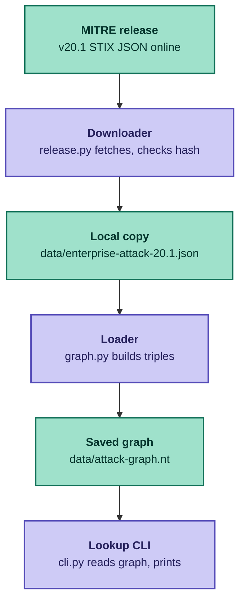

# Issue #3: load full ATT&CK Enterprise data

What was built: `attack-graph load` downloads the pinned ATT&CK Enterprise release (v20.1), checks it, turns it into the graph, and saves the graph. Lookups then use that data instead of the small fixture.

Related: [glossary](glossary.md), [Python for Node/TS developers](python-for-node-devs.md), [issue #2](issue-02-fixture-graph-cli.md).

## The big picture

**Key**

- **Teal boxes are data:** files and stored facts.
- **Purple boxes are code:** our own Python.



1. `load` downloads the pinned file, unless the local copy already exists.
2. It checks the SHA-256 fingerprint. A mismatch stops everything.
3. The same loader from issue #2 builds the graph.
4. The graph is saved as sorted N-Triples, swapped in atomically.
5. `technique` and `group` lookups read the saved graph. With no saved graph, they use the fixture.

Re-running `load` rebuilds the file from scratch, so nothing is duplicated.

## Files and what they do

- `src/attack_graph/release.py`: the pinned version, URL, and checksum; download, verify, atomic write.
- `src/attack_graph/graph.py`: new `to_ntriples` and `from_store` for saving and reading the graph.
- `src/attack_graph/cli.py`: new `load` command; lookups pick loaded data, then fixture.
- `tests/test_load_cli.py`: offline tests with a fake downloader.
- `tests/conftest.py`: runs each test in an empty temp folder so `data/` never leaks in.
- `.gitignore`: ignores `data/`.
- `docs/decisions.md`: records the pinned version and storage choice.

## Code tour

### release.py

- `Release` is a read-only record: version, URL, SHA-256. `PINNED` is the one we use.
- `ensure_downloaded` returns the local file. If missing, it fetches, checks the hash, and writes it. Wrong hash raises `ReleaseError` and writes nothing.
- `fetch` is passed in. Production uses `http_fetch`. Tests pass a fake, so they never touch the network.
- `write_atomically` writes `name.part`, then `os.replace` renames it. A crash can't leave a half file.

### graph.py additions

- `to_ntriples` serializes the graph and sorts the lines, so the same facts always give the same bytes.
- `from_store` reads that file back. Bad content raises `DataFileError`.

### cli.py additions

- `main(argv, *, fetch, release)` takes the downloader and release as optional arguments. Tests inject fakes.
- `_run_load` downloads, builds, saves, prints. Errors print to stderr and return exit code 2.
- `_load` picks the source: `--data` file, else saved graph, else fixture.

## What to try

1. **Load and query real data.**

   ```bash
   uv run attack-graph load
   uv run attack-graph group APT29
   ```

2. **Prove re-running is safe.** The fingerprint of the saved graph is the same after a second load:

   ```bash
   shasum data/attack-graph.nt
   uv run attack-graph load
   shasum data/attack-graph.nt
   ```

3. **Compare with the fixture.** Delete `data/attack-graph.nt` and run `group APT29` again. You get the small fixture answer. Run `load` to get the full one back.
