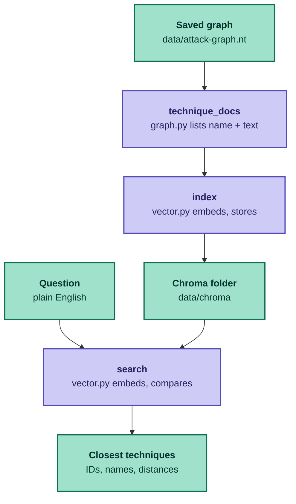

# Issue #4: vector search by meaning

What was built: `attack-graph index` embeds every technique into Chroma, and `attack-graph search "..."` returns the techniques closest in meaning to a plain-English question.

Related: [glossary](glossary.md), [Python for Node/TS developers](python-for-node-devs.md), [issue #3](issue-03-load-full-data.md).

## The big picture

**Key**

- **Teal boxes are data:** files and stored facts.
- **Purple boxes are code:** our own Python.



Reading the diagram, box by box:

- **Saved graph:** the ATT&CK facts from issue #3. It is the source of truth for which techniques exist.
- **technique_docs:** one SPARQL query pulls every technique's ID, name, and description into a plain list. Nothing is embedded yet.
- **index:** glues each technique into one text, `"Name. Description"`. The embedding model turns each text into 384 numbers. It stores numbers, ID, and name in Chroma. It deletes the old collection first, so re-running never duplicates.
- **Chroma folder:** the stored vectors on disk. `index` writes it and `search` reads it, so `search` never touches the graph.
- **Question:** your plain-English text, like "criminals lock my files and demand payment".
- **search:** embeds the question with the same model (vectors only compare fairly if the same model made both), then asks Chroma for the nearest vectors by cosine distance. Blank questions and bad limits are rejected here.
- **Closest techniques:** ID, name, and distance, nearest first. The CLI prints ID and name.

Techniques are embedded once, at `index` time. At `search` time only the question is embedded.

No LLM is involved anywhere here.

## Files and what they do

- `src/attack_graph/vector.py`: the `VectorStore` interface, `ChromaVectorStore`, and the default embedding model.
- `src/attack_graph/graph.py`: new `TechniqueDoc` and `technique_docs()`, the text to embed.
- `src/attack_graph/cli.py`: new `index` and `search` commands.
- `tests/test_vector_store.py`: idempotency, ordering, errors, and two real-meaning tests.
- `tests/test_search_cli.py`: the two commands end to end.
- `tests/fake_embedder.py`: tiny offline stand-in for the model.
- `pyproject.toml`: adds `chromadb` and the `model` test marker.
- `docs/decisions.md`: records the model and rebuild choices.

## Code tour

### vector.py

- `VectorStore` is the whole interface: `index(techniques)` and `search(question, limit)`. Later code depends on this, not on Chroma.
- `Hit` is one result: ID, name, and distance (smaller is closer).
- `Embed` is any function from texts to vectors. `default_embed` wraps Chroma's bundled model and loads it lazily.
- `ChromaVectorStore.index` deletes the old collection, then adds everything. Idempotent by construction.
- `ChromaVectorStore.search` rejects blank questions and bad limits, then asks Chroma for the nearest. Missing index raises `VectorStoreError`.

### graph.py addition

- `technique_docs()` runs one SPARQL query for every technique's ID, name, and description, sorted by ID.

### cli.py additions

- `main(..., embed=default_embed)` takes the embedder as an optional argument; tests pass the fake.
- `search` skips loading the graph: it only needs the Chroma folder.

## What to try

1. **Index and search the full data.** The first `index` downloads the model once.

   ```bash
   uv run attack-graph load
   uv run attack-graph index
   uv run attack-graph search "how do attackers get in through email?" --limit 10
   ```

2. **Ask in your own words.**

   ```bash
   uv run attack-graph search "criminals lock my files and demand payment"
   ```

3. **Prove re-running is safe.** Run `index` twice; the same search gives the same list.
4. **Run the real-model tests alone:** `uv run pytest -m model`.
