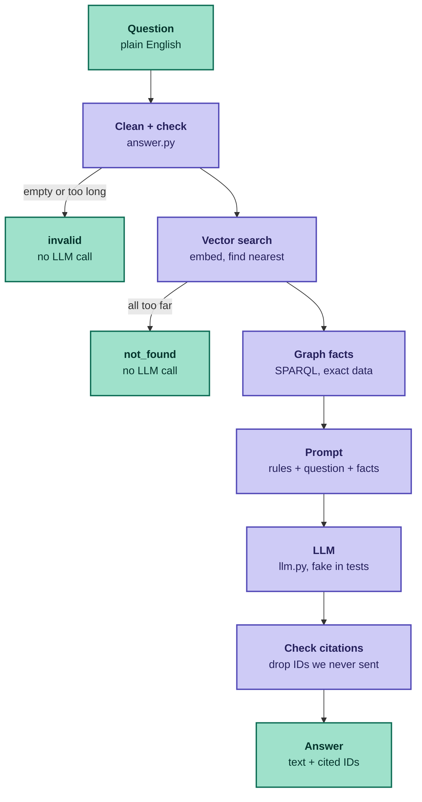

# Issue #5: ask pipeline with a fake LLM

What was built: `attack-graph ask "..."` finds techniques by meaning, pulls their exact facts from the graph, asks an LLM to write a short answer, and checks that the answer cites only techniques we really retrieved. Off-topic questions are refused without calling the LLM.

Related: [glossary](glossary.md), [Python for Node/TS developers](python-for-node-devs.md), [issue #4](issue-04-vector-search.md).

## The big picture

**Key**

- **Teal boxes are data:** questions, facts, answers.
- **Purple boxes are code:** our own Python.



Each box above, in order:

1. **Question:** your plain-English text.
2. **Clean + check:** strip control characters. Empty or over 500 characters is `invalid`, with no LLM call.
3. **Vector search:** embed the question into numbers, then ask Chroma for the 5 techniques with the closest numbers.
4. **Too far?:** drop hits with distance above 0.75. Nothing left means `not_found`, with no LLM call.
5. **Graph facts:** a SPARQL query fetches each technique's exact tactics, groups, software, and mitigations.
6. **Prompt:** fixed rules, then the question and facts, both wrapped in tags and labeled as data.
7. **LLM:** writes the short answer. A fake in tests, an offline stand-in in the CLI.
8. **Check citations:** keep only technique IDs in the reply that we actually retrieved. None left means the reply is discarded.
9. **Answer:** the text, the cited techniques, and everything retrieved.

## Files and what they do

- `src/attack_graph/answer.py`: `Answerer.ask`, the `Answer` result, the prompt, and the citation check.
- `src/attack_graph/llm.py`: the one-method `LLM` interface, `LLMError`, and `OfflineLLM` for the CLI.
- `src/attack_graph/cli.py`: new `ask` command; `main` takes an optional `llm`.
- `tests/test_ask.py`: all pipeline behavior, through `ask` only.
- `tests/test_ask_cli.py`: the command prints and exits correctly.
- `tests/fake_llm.py`: `FakeLLM` (cites the first fact) and `ScriptedLLM` (fixed reply or error).
- `tests/fake_embedder.py`: new `fake_word_embed`, so unrelated texts are exactly unrelated.
- `docs/decisions.md`: status result, 0.75 cutoff, citation checking, LLM interface.

## Code tour

### llm.py

- `LLM` is a `Protocol` with `complete(system, prompt) -> str`. Anything with that method fits.
- `LLMError` is what any provider raises when it fails.
- `OfflineLLM` restates the first fact and cites it. It exists so the CLI runs before issue #6.

### answer.py

- `Answer` is a frozen dataclass: `status`, `text`, `cited`, `retrieved`. Status is `answered`, `not_found`, `invalid`, or `error`.
- `Answerer.__init__` takes the vector store, graph, and LLM. Nothing is built inside, so tests inject fakes.
- `ask` runs the steps in order and returns early on each failure case.
- `_clean` drops control characters. `_build_prompt` wraps question and facts in tags.
- `_verified_citations` finds IDs with a regex and keeps only retrieved ones, in order.

### cli.py additions

- `_run_ask` builds the `Answerer`, prints the result, and picks the exit code: 0 answered, 1 not found, 2 invalid or setup problem.

## What to try

1. **Ask against the fixture.**

   ```bash
   uv run attack-graph index
   uv run attack-graph ask "how do attackers get in through email?"
   ```

2. **See a refusal:** `uv run attack-graph ask "how to bake sourdough bread"` prints "Not found" and exits 1.
3. **Check the exit code:** `echo $?` right after.
4. **Run the real-model test:** `uv run pytest -m model tests/test_ask.py`.
