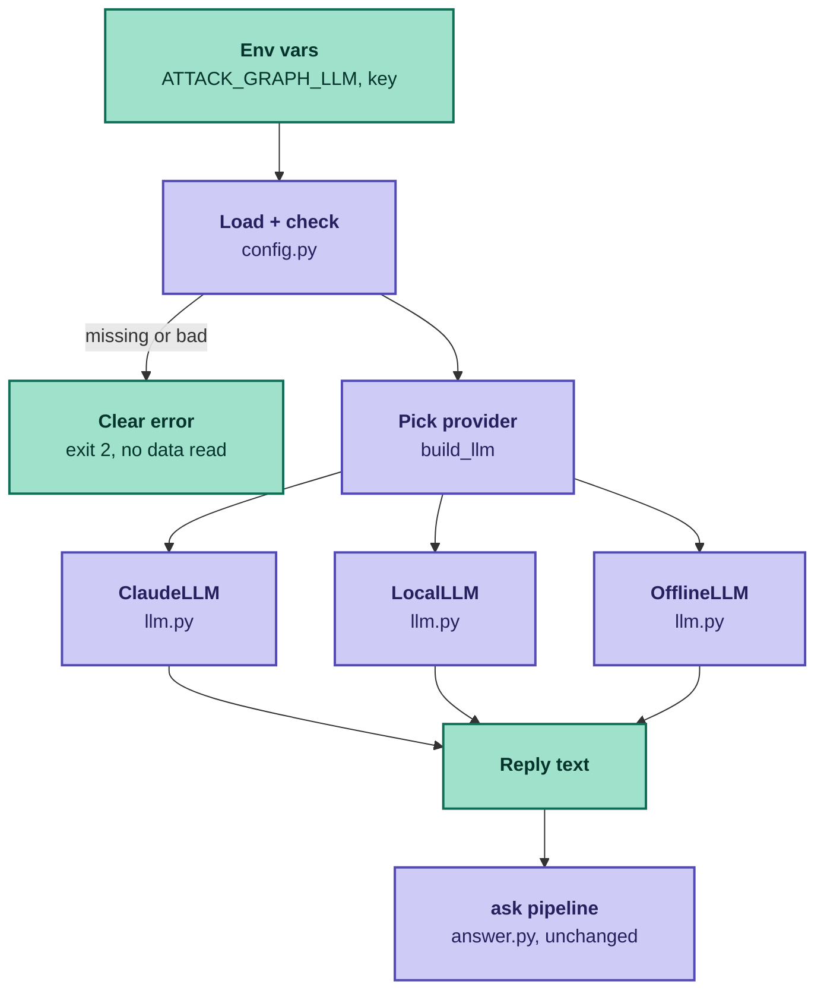

# Issue #6: real LLM client and configuration

What was built: `attack-graph ask` now talks to the real Claude API. Which model answers is chosen by environment variables, checked before anything else runs. A local model and an offline stand-in are the other choices.

Related: [glossary](glossary.md), [Python for Node/TS developers](python-for-node-devs.md), [issue #5](issue-05-ask-pipeline.md).

## The big picture

**Key**

- **Teal boxes are data:** settings, prompts, replies.
- **Purple boxes are code:** our own Python.



1. `ask` reads the environment and validates it first, so a bad setup fails before any data loads.
2. `ATTACK_GRAPH_LLM` picks the provider; the default is `claude`.
3. Each provider has the same one method, `complete(system, prompt)`, so the pipeline does not change.
4. Any provider failure becomes a bare `LLMError`; `ask` turns that into its generic error reply.

## Files and what they do

- `src/attack_graph/config.py`: reads and validates env vars, builds the chosen LLM.
- `src/attack_graph/llm.py`: new `ClaudeLLM` and `LocalLLM` beside `OfflineLLM`.
- `src/attack_graph/cli.py`: `main` takes an optional `env`; `ask` builds its LLM from config.
- `tests/test_llm_config.py`: provider choice and fail-fast checks, through the `ask` command.
- `tests/test_llm_providers.py`: Claude and local replies through `ask`, with fake networks.
- `tests/test_live_claude.py`: one opt-in test against the real API.
- `.env.example`: every setting, no real values.
- `pyproject.toml`: adds the `anthropic` package and the `live` test marker.
- `docs/decisions.md`: provider config, Claude details, local model, test approach.

## Code tour

### config.py

- `LLMSettings` is a frozen dataclass; `api_key` has `repr=False` so printing it never shows the key.
- `load_llm_settings(env)` takes a dict (not `os.environ` directly) so tests pass their own.
- Blank values count as missing. Errors name the variable, never the value.
- `build_llm` imports the Anthropic SDK only when Claude is chosen.

### llm.py additions

- `ClaudeLLM` sends rules as `system` and question plus facts as the user message.
- It wraps every SDK error in `LLMError` with no details, and treats a refusal or empty reply as a failure.
- `LocalLLM` posts to `<url>/chat/completions` with the standard library; the `post` function is injectable.

### cli.py changes

- When `command == "ask"` and no `llm` was injected, it builds one from config and exits 2 on `ConfigError`.
- Other commands ignore the LLM settings entirely.

## What to try

1. **See the fail-fast message:** `uv run attack-graph ask "phishing"` with no key prints which variable is missing and exits 2.
2. **Try it with no key:**

   ```bash
   ATTACK_GRAPH_LLM=offline uv run attack-graph ask "how do attackers get in through email?"
   ```

3. **Use real Claude** (needs the index first, and your own key):

   ```bash
   uv run attack-graph index
   export ANTHROPIC_API_KEY=...   # from console.anthropic.com
   uv run attack-graph ask "how do attackers get in through email?"
   ```

4. **Run the live test:** `uv run pytest -m live`.
