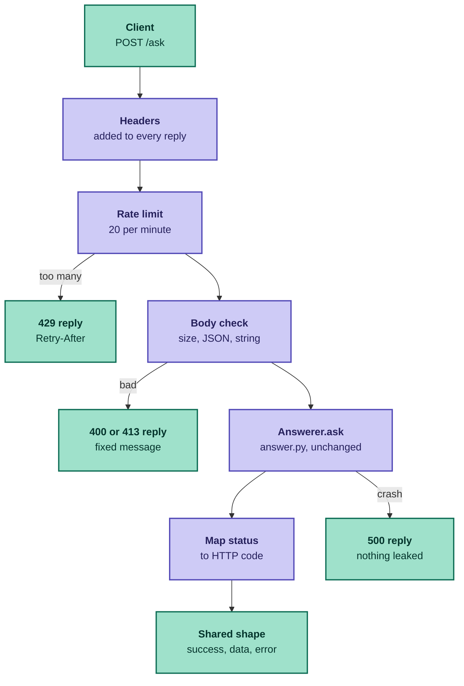

# Issue #7: HTTP API

What was built: `attack-graph serve` starts a small web server. `POST /ask` runs the same `ask` pipeline as the CLI and `GET /health` says it is alive. Every reply has one shape, oversized or abusive requests are refused, and errors never reveal internals.

Related: [glossary](glossary.md), [Python for Node/TS developers](python-for-node-devs.md), [issue #5](issue-05-ask-pipeline.md), [issue #6](issue-06-real-llm-client.md).

## The big picture

**Key**

- **Teal boxes are data:** requests and replies.
- **Purple boxes are code:** our own Python.



1. A request comes in; security headers are added to whatever reply leaves.
2. The rate limiter counts requests per client address in the last 60 seconds.
3. The body must be small, valid JSON, an object with a string `question`.
4. `ask` does the real work. The API only turns its `status` into an HTTP code.
5. Any surprise becomes a fixed "Something went wrong." with no details.

## Files and what they do

- `src/attack_graph/api.py`: the app, rate limiter, body checks, error mapping, headers.
- `src/attack_graph/cli.py`: new `serve` command; shares the config check with `ask`.
- `tests/test_api.py`: every behavior through the HTTP test client, fake LLM, fixture data.
- `tests/test_serve_cli.py`: `serve` defaults, options, and fail-fast config.
- `pyproject.toml`: adds `fastapi`, `uvicorn`, and `httpx` (test client, dev only).
- `docs/decisions.md`: framework pick, status mapping, safeguards and their limits.

## Code tour

### api.py

- `create_app(answerer, rate_limit=..., clock=...)` builds the app. Passing the `clock` lets tests move time by hand.
- `_SlidingWindowLimiter` keeps a queue of recent request times per client and drops the old ones.
- `_read_question` checks size twice (header, then actual bytes), then parses JSON by hand so no framework error text escapes.
- `_ok` and `_fail` are the only ways to build a reply, which is why the shape never varies.
- The `ask` route catches every exception and logs only its type, never its message or the question.
- `answered` and `not_found` are 200; `invalid` 400; LLM failure 502; missing index 503; crash 500.

### cli.py changes

- `serve` listens on `127.0.0.1:8000` by default. `run_server` is injectable so tests never open a port.

## What to try

1. **Start it** (offline answers, no key needed):

   ```bash
   uv run attack-graph index
   ATTACK_GRAPH_LLM=offline uv run attack-graph serve
   ```

2. **Ask:**

   ```bash
   curl -s localhost:8000/ask -d '{"question": "how do attackers use email?"}'
   ```

3. **Health:** `curl -s localhost:8000/health`.
4. **See the shared error shape:** `curl -s localhost:8000/ask -d 'oops'`.
