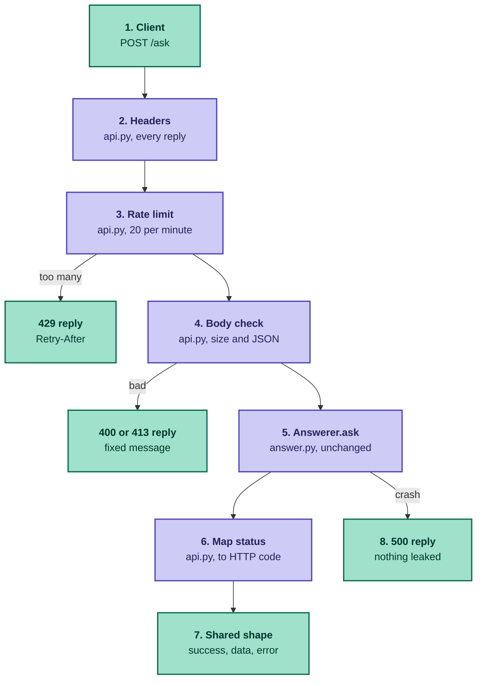

# Issue #7: HTTP API

What was built: `attack-graph serve` starts a small web server. `POST /ask` runs the same `ask` pipeline as the CLI and `GET /health` says it is alive. Every reply has one shape, oversized or abusive requests are refused, and errors never reveal internals.

Related: [glossary](glossary.md), [Python for Node/TS developers](python-for-node-devs.md), [issue #5](issue-05-ask-pipeline.md), [issue #6](issue-06-real-llm-client.md).

## The big picture

**Key**

- **Teal boxes are data:** requests and replies.
- **Purple boxes are code:** our own Python.



1. **Client:** a program (curl, a website) sends `{"question": "..."}` to `POST /ask`.
2. **Headers:** every reply carries small instructions telling browsers to be strict, such as "don't guess the file type" and "don't cache this".
3. **Rate limit:** counts requests per client. Over 20 in a minute gets **429 "slow down"**, which protects your Claude bill.
4. **Body check:** the request must be under 4 KB, valid JSON, with a text `question`. If not, it returns **400 or 413** with a fixed, boring message.
5. **`Answerer.ask`:** the real work from issues #4 to #6: vector search, graph lookup, then the LLM. The API does not change it.
6. **Map status:** the API turns `ask`'s result into a web code. `answered` and `not_found` are 200, `invalid` is 400, `error` is 502.
7. **Shared shape:** every reply has the same three fields, `success`, `data`, `error`, so a client needs only one parser.
8. **500 reply:** if something crashes unexpectedly, the client sees only "Something went wrong." The real cause goes to the log as an exception type only, so no stack traces, paths or keys leak.

## Files and what they do

- `src/attack_graph/api.py`: the app, rate limiter, body checks, error mapping, headers.
- `src/attack_graph/cli.py`: new `serve` command; shares the config check with `ask`.
- `tests/test_api.py`: every behavior through the HTTP test client, fake LLM, fixture data.
- `tests/test_serve_cli.py`: `serve` defaults, options, and fail-fast config.
- `pyproject.toml`: adds `fastapi`, `uvicorn`, and `httpx` (test client, dev only).
- `docs/decisions.md`: framework pick, status mapping, safeguards and their limits.

## Code tour

### api.py

- `create_app(answerer, rate_limit=..., clock=...)` builds the app. Passing the `clock` lets tests move time by hand.
- `_SlidingWindowLimiter` keeps a queue of recent request times per client and drops the old ones.
- `_read_question` checks size twice (header, then actual bytes), then parses JSON by hand so no framework error text escapes.
- `_ok` and `_fail` are the only ways to build a reply, which is why the shape never varies.
- The `ask` route catches every exception and logs only its type, never its message or the question.
- `answered` and `not_found` are 200; `invalid` 400; LLM failure 502; missing index 503; crash 500.

### cli.py changes

- `serve` listens on `127.0.0.1:8000` by default. `run_server` is injectable so tests never open a port.

## What to try

1. **Start it** (offline answers, no key needed):

   ```bash
   uv run attack-graph index
   ATTACK_GRAPH_LLM=offline uv run attack-graph serve
   ```

2. **Ask:**

   ```bash
   curl -s localhost:8000/ask -d '{"question": "how do attackers use email?"}'
   ```

3. **Health:** `curl -s localhost:8000/health`.
4. **See the shared error shape:** `curl -s localhost:8000/ask -d 'oops'`.
