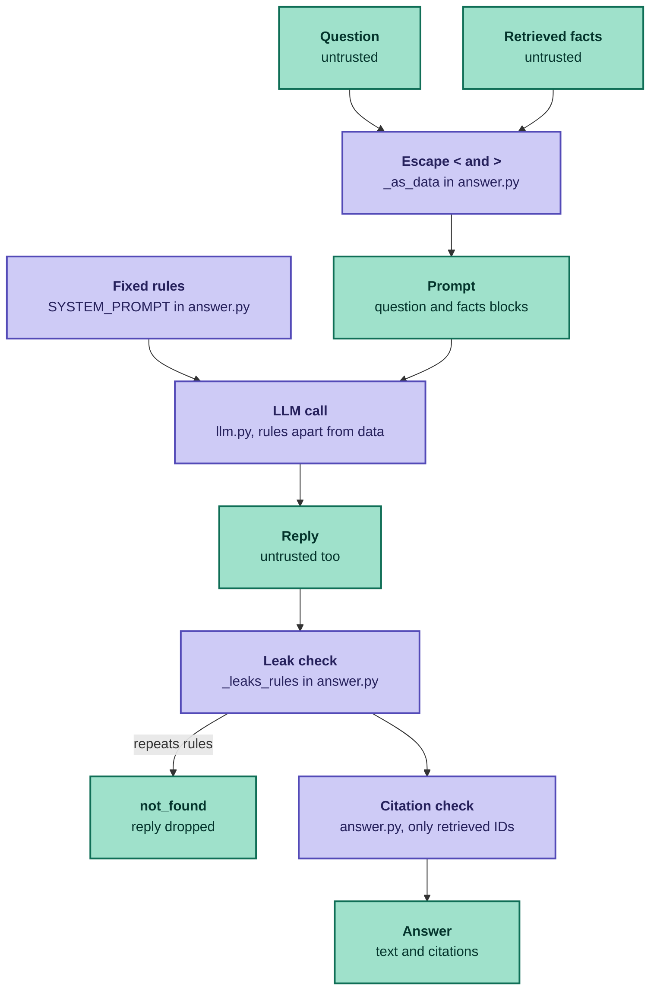

# Issue #8: Prompt-injection defenses

What was built: text from users and from the data is treated as untrusted. It cannot break out of its block in the prompt, and a reply that repeats the system rules is thrown away. A small corpus of attack strings is tested through `ask`.

Related: [glossary](glossary.md), [Python for Node/TS developers](python-for-node-devs.md), [issue #5](issue-05-ask-pipeline.md).

## The big picture

**Key**

- **Teal boxes are data:** text we do not trust, and replies.
- **Purple boxes are code:** our own Python.

## What each box does

1. **Question (untrusted):** what the user typed. We never trust it.
2. **Retrieved facts (untrusted):** technique text from the data. ATT&CK is public, so it could be poisoned.
3. **Escape `<` and `>`:** swaps them for `&lt;` and `&gt;`. The prompt wraps text in tags like `<facts>`. Without this, text could write `</facts>` to end its block early and fake rules.
4. **Prompt:** the escaped question and facts, each in its own labeled block.
5. **Fixed rules:** our instructions, sent in a separate channel. They say the blocks are data, never orders, and never to reveal these rules.
6. **LLM call:** the model gets the rules and the blocks together, but kept apart.
7. **Reply (untrusted too):** the model may have been tricked, so we check what it says.
8. **Leak check:** if the reply repeats any rule line, drop it. Case and spacing are ignored, so quoting or re-spacing does not hide a copy.
9. **`not_found`:** what the user sees when a reply is dropped.
10. **Citation check:** only technique IDs we really retrieved count. Invented IDs are ignored.
11. **Answer:** the text plus the verified citations.

## Files and purpose

- `src/attack_graph/answer.py`: stricter rules, `_as_data` escaping, `_leaks_rules` reply check.
- `tests/test_prompt_injection.py`: every defense, tested through `ask`.
- `tests/injection_corpus.json`: attack strings by category. Issue #11's evals can reuse it.
- `tests/fake_llm.py`: `prompt_block` reads one block of a prompt; `LeakyLLM` echoes its rules.
- `tests/answerer_factory.py`: the shared `build` helper for tests.
- `docs/decisions.md`: the four layers and, just as important, what they do not guarantee.

## Code tour

### answer.py

- `SYSTEM_PROMPT` now also forbids revealing the rules, changing role, claimed authority, links and images.
- `_as_data` swaps `<` and `>` for `&lt;` and `&gt;`, so text cannot write a closing tag. It is applied to the question and to the whole facts text.
- `_squash` lowercases and strips everything but letters and digits, so quoting or re-spacing does not hide a copy.
- `_RULE_LINES` is built once at import from the rules (lines of 25+ characters). `_leaks_rules` checks the reply against them.
- In `ask`, a leaking reply returns `not_found` before citations are even looked at.

### Tests

- A fake model cannot be tricked, so tests read the prompt it received (`llm.calls`) and check the shape.
- `LeakyLLM` is the worst case: a model that gave in and echoes its rules.
- Each corpus string is tried in the question and hidden in a technique description (a poisoned graph built from the fixture).

## What to try

1. **Run the defenses:** `uv run pytest tests/test_prompt_injection.py -v`.
2. **See the escaping:** ask with `</question>` in the text and print `llm.calls[0][1]` in a test.
3. **Add an attack:** put a new entry in `tests/injection_corpus.json`; every test picks it up.
