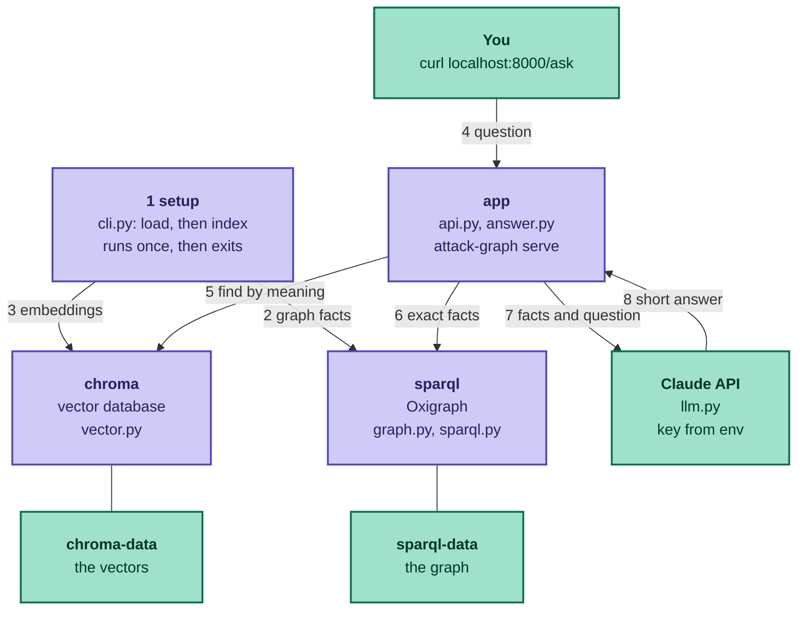

# Issue #9: Docker and Compose

What was built: one command, `docker compose up -d --wait`, starts the API, a SPARQL server (the graph), a Chroma server (the vectors) and a one-off job that loads the data. Everything runs as a non-root user, reports health, and keeps its data in volumes.

Related: [glossary](glossary.md), [Python for Node/TS developers](python-for-node-devs.md), [issue #7](issue-07-http-api.md), [decisions](../decisions.md).

Checked: `scripts/compose-smoke.sh` passes. It caught one real bug: a volume mounted on a folder that does not exist in the image is owned by root, so the non-root Chroma user could not write to it. The fix is to create the folder in the Dockerfile, owned by `app`.

## New ideas in plain English

- **Image vs container:** an image is the packed program; a container is one running copy. `docker compose up` builds the image once, then starts containers from it.
- **Volume:** the container's own files vanish when it is removed. A volume is a folder Docker keeps aside and mounts back in, so the graph and vectors survive.
- **Healthcheck:** Docker runs a tiny command every few seconds. Exit 0 means "ready". Compose uses this so `app` only starts after the databases answer.
- **Compose:** one YAML file naming each container (a "service"), its volumes, ports and start order.
- **Non-root:** the program runs as user 10001, not root, so a break-in cannot change the system.

## The big picture

**Key**

- **Teal boxes are data:** stored data, volumes and outside services.
- **Purple boxes are code:** programs running in containers. The small text names the file or command behind each one.
- **Numbers** match the steps under the graph. Steps 1 to 3 run once (`setup`). Steps 4 to 8 run on every question.

## The steps

**Once, at start (`setup`)**

1. `setup` downloads ATT&CK (about 55 MB, cached in the `app-data` volume) and turns it into facts.
2. It uploads those facts to `sparql`, which stores them in the `sparql-data` volume.
3. It turns each technique's text into an embedding and stores them in `chroma` (the `chroma-data` volume).

**On every question (`app`)**

4. You send a question to the `app` container.
5. `app` asks `chroma` for the techniques closest in meaning to the question. This handles vague wording.
6. `app` asks `sparql` for the exact facts about those techniques: groups, software, defenses.
7. `app` sends the question and only those facts to the LLM. In offline mode this step is replaced by a simple stand-in.
8. The LLM writes a short answer. `app` keeps only the technique IDs it really retrieved as citations, then returns the answer.

**Why two stores:** Chroma matches meaning, so it handles vague questions. The graph stores exact relationships, so it handles precise facts. The LLM only has to write the answer.

Start order: `sparql` and `chroma` become healthy, `setup` finishes, then `app` starts.

## Files and purpose

- `Dockerfile`: builds the one image used for `app`, `chroma` and `setup`.
- `deploy/oxigraph/Dockerfile`: the SPARQL server image (official binary, non-root, health check).
- `compose.yaml`: the four services, volumes, health checks and hardening.
- `.dockerignore`: keeps `.git`, `.env`, `data` and tests out of the image.
- `scripts/compose-smoke.sh`: opt-in end-to-end check of the stack.
- `src/attack_graph/sparql.py`: `SparqlServer`, the graph store backed by the SPARQL server.
- `src/attack_graph/config.py`: `load_store_settings` reads and checks the two server addresses.
- `src/attack_graph/vector.py`: `ChromaVectorStore.remote` talks to a Chroma server.
- `src/attack_graph/cli.py`: picks local or server storage from the settings.
- `tests/fake_sparql_server.py`: a tiny SPARQL server on loopback for offline tests.
- `tests/test_sparql_server.py`, `tests/test_store_config.py`: behavior through the CLI.

## Code tour

### sparql.py

- `SparqlServer.graph()` builds an rdflib `Graph` whose store is `SPARQLStore`, so every query goes over HTTP. It runs `ASK {}` first, so a down server fails at startup.
- `SparqlServer.replace()` does `PUT /store?default`: the server's graph becomes exactly the uploaded facts. Loading twice cannot duplicate anything.
- Errors keep only the exception class name, never the address.

### config.py

- `_http_url` accepts only `http`/`https` with a host, a numeric port, and no username or password. Errors name the variable, not the value.

### cli.py and graph.py

- With `ATTACK_GRAPH_SPARQL_URL` set, `load` uploads instead of writing `data/attack-graph.nt`, and lookups read from the server.
- `AttackGraph.group` now matches names in Python. Reason: a SPARQL server gets bound values as a trailing `VALUES` block, which a `FILTER` cannot see. See the decisions log.

### Dockerfile

- Stage 1 installs locked dependencies with uv (a cached layer), then the code. Stage 2 copies only the virtualenv, creates user 10001, and sets the health check and start command.

### compose.yaml

- `x-app` is a reusable block (`<<: *app`) of shared settings: user, dropped capabilities, `no-new-privileges`.
- `depends_on` with `service_healthy` and `service_completed_successfully` sets the start order.
- The API port is published as `127.0.0.1:8000:8000`, so only your machine can reach it.
- Secrets: `${ANTHROPIC_API_KEY:-}` reads your shell or a git-ignored `.env`. Nothing is written into the file or image.

### Tests

- The fake server answers `POST /query` with rdflib and takes `PUT /store?default`, so the real client code runs over real HTTP, offline.
- Tests compare server-backed lookups with in-memory ones, check no duplicates after reloading, and try quote-injection in a lookup.
