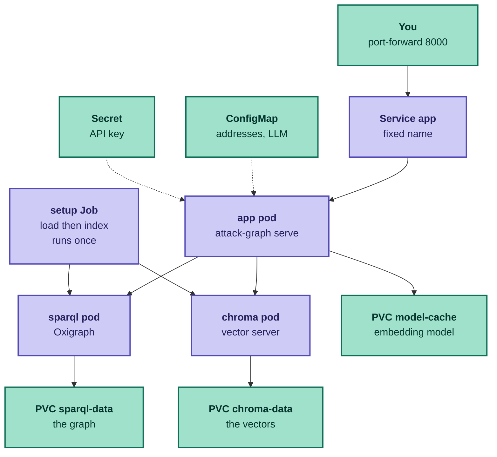

# Issue #10: Kubernetes on a local cluster

What was built: plain YAML files in `k8s/` that run the same system as Compose (API, SPARQL server, Chroma server, one-off data setup) on a local Kubernetes cluster made with kind. No Helm.

Related: [glossary](glossary.md), [Python for Node/TS developers](python-for-node-devs.md), [issue #9](issue-09-docker-compose.md), [decisions](../decisions.md).

Note: this was written on a machine with no Docker, kind or kubectl. The tests check the YAML offline; nothing has run on a real cluster yet. Run `scripts/k8s-smoke.sh` once to prove it.

## New ideas in plain English

- **Kubernetes:** a program that keeps your containers running the way you described in YAML, and fixes drift (a crashed container is replaced).
- **Cluster / node:** the machine(s) Kubernetes manages. kind makes a one-node cluster inside a Docker container.
- **Pod:** the smallest thing Kubernetes runs: one or more containers that share a network and start and stop together.
- **Deployment:** "keep 1 copy of this pod running". It replaces the pod if it dies or you change the YAML.
- **Service:** a fixed name and address in front of pods (pods get new addresses each time). `http://sparql:7878` works inside the cluster because of the `sparql` Service.
- **ConfigMap:** plain settings, handed to pods as environment variables.
- **Secret:** the same for sensitive values (the API key). Only base64 encoded, so still treat it as sensitive.
- **PVC (PersistentVolumeClaim):** "I need 2 GB of disk that outlives pods". Replace the pod and it gets the same disk back.
- **Probes:** health checks. Readiness = send traffic yet? Liveness = restart if this fails. Startup = give a slow boot more time.
- **Job:** a pod that runs once to completion (our data load), unlike a Deployment.
- **Namespace:** a named folder for objects; delete it to remove everything.
- **kubectl:** the command-line tool that talks to the cluster. `apply -f` means "make the cluster match these files".

## The big picture

**Key**

- **Teal boxes are data:** disks, settings and secrets.
- **Purple boxes are code:** programs running in pods.

## What each box does

1. **You, port-forward:** the cluster is closed from outside. `kubectl port-forward` opens a tunnel from `localhost:8000` into it.
2. **Service app:** a permanent name for the API. The app pod gets a new address every time it restarts, so the Service gives everyone one name that always points at the live pod. You can think of it as a contact entry that always rings the current phone.
3. **app pod:** runs `attack-graph serve`. It takes your question, searches, and asks Claude. It stores no data.
4. **sparql pod (Oxigraph):** the graph database. It holds exact facts, like which group uses which technique.
5. **chroma pod:** the vector database. It finds techniques by meaning. The vectors are made by MiniLM, a small model that turns text into numbers.
6. **setup Job:** runs once. It loads the facts into sparql, embeds every technique into chroma, then exits.
7. **ConfigMap:** plain settings, like where sparql and chroma live.
8. **Secret:** your API key, kept out of the image and out of git.
9. **PVC (sparql-data, chroma-data):** a request for a disk that outlives the pod. Delete the pod and the new one gets the same disk back, so the data is still there.
10. **PVC model-cache:** the same idea for the ~80 MB MiniLM download, so a restart does not fetch it again.

**One question, start to finish:** you ask, the Service sends it to the app pod, the app embeds it and asks chroma for the closest techniques, asks sparql for their exact facts, and sends both to Claude, which writes the answer.

## Deploy it (step by step)

Needs Docker, [kind](https://kind.sigs.k8s.io/) and kubectl. Run from the repo root.

1. Make a cluster: `kind create cluster --name attack-graph`
2. Build the two images: `docker build -t attack-graph-rag:local .` and `docker build -t attack-graph-oxigraph:local deploy/oxigraph`
3. Copy them into the cluster (it cannot see your Docker images otherwise): `kind load docker-image attack-graph-rag:local attack-graph-oxigraph:local --name attack-graph`
4. Create the namespace first: `kubectl apply -f k8s/00-namespace.yaml`
5. Create the secret from your environment (skip if you set `ATTACK_GRAPH_LLM: offline` in `k8s/10-configmap.yaml`): `kubectl -n attack-graph create secret generic attack-graph-secrets --from-literal=ANTHROPIC_API_KEY="$ANTHROPIC_API_KEY"`
6. Apply everything: `kubectl apply -f k8s/`
7. Wait for the data load (first run downloads about 135 MB): `kubectl -n attack-graph wait --for=condition=complete job/setup --timeout=900s`
8. Check pods: `kubectl -n attack-graph get pods` (all `Running` and `1/1`)
9. Reach the API: `kubectl -n attack-graph port-forward svc/app 8000:8000`, then in another terminal `curl -s localhost:8000/ask -d '{"question": "how do attackers get in through email?"}'`
10. Prove persistence: `kubectl -n attack-graph delete pod -l 'app in (sparql,chroma,app)'`, wait for the new pods, ask again. The answer still works and the setup Job did not re-run.
11. Clean up: `kubectl delete namespace attack-graph` (this removes the disks too), or `kind delete cluster --name attack-graph`.

Useful when stuck: `kubectl -n attack-graph describe pod <name>` (events at the bottom), `kubectl -n attack-graph logs deploy/app`.

## Files and purpose

- `k8s/00-namespace.yaml`: the namespace, set to enforce the strict `restricted` pod security level.
- `k8s/10-configmap.yaml`: non-secret settings, including the store addresses.
- `k8s/examples/secret.example.yaml`: template only, with the command that creates the real Secret.
- `k8s/20-volumes.yaml`: four disk requests (graph, vectors, ATT&CK download, model cache).
- `k8s/30-sparql.yaml`, `31-chroma.yaml`, `32-app.yaml`: the three Deployments with probes, limits and non-root settings.
- `k8s/40-services.yaml`: the three Services (all inside-cluster only).
- `k8s/50-setup-job.yaml`: the one-off load and index, after waiting for both stores.
- `tests/test_k8s_manifests.py`: offline checks (no real key, non-root, probes, limits, names line up).
- `scripts/k8s-smoke.sh`: opt-in end-to-end check on a throwaway kind cluster.

## Code tour

### Config and secrets

- `envFrom: configMapRef` turns every ConfigMap entry into an environment variable.
- `secretKeyRef` copies one Secret entry into one variable; `optional: true` lets offline runs skip the Secret.
- The image holds neither: change a setting with `kubectl edit configmap` and restart, no rebuild.

### Deployments

- `selector.matchLabels` and the pod `labels` must match: that is how a Deployment finds its pods, and how a Service finds them too.
- `strategy: Recreate` stops the old pod before the new one starts, so two pods never use one disk.
- `securityContext` (pod level and container level) sets uid 10001, no privilege escalation, no capabilities, default seccomp.
- `resources.requests` is what the scheduler reserves; `limits.memory` is where the container is killed if it goes over.

### Probes

- The app uses `GET /health` for all three probes; `startupProbe` allows up to 5 minutes for the first model load.
- Oxigraph has no health URL, so an `exec` probe runs the same tiny Python check as the Docker image.

### Setup Job

- An `initContainer` waits for both servers, standing in for Compose's `depends_on`.
- The main container runs `attack-graph load && attack-graph index`; `backoffLimit: 4` retries on failure.

### Tests

- The tests read the YAML with PyYAML and check promises: no Secret is applied, no key-shaped text, every container non-root with limits, probes hit `/health`, Services select real pods, every PVC a pod mounts exists.
