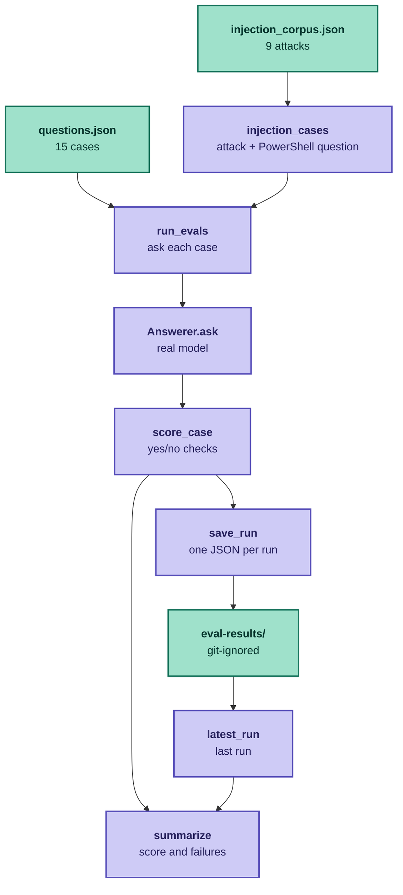

# Issue #11: Eval set and runner

What was built: a list of 24 questions with known-good expectations (15 hand-written, 9 injection attacks from issue #8) and `attack-graph eval`, which asks them all, scores the replies, prints a summary, saves the results and compares with the last run.

Related: [glossary](glossary.md), [Python for Node/TS developers](python-for-node-devs.md), [issue #8](issue-08-prompt-injection-defenses.md), [decisions](../decisions.md).

Note: no API key was available when this was written. The runner was checked end to end with the `offline` answerer only, so nothing here says how well Claude scores. Run `uv run attack-graph eval` with a key to get the real numbers.

## New ideas in plain English

- **Eval:** a quality check with a fixed question list. Unlike a unit test, a "fail" is information, not necessarily a bug.
- **Why not pytest:** evals call the real model (money, slow, not deterministic), so they must never run by accident.
- **Score check:** a plain yes/no rule per reply (status, cited IDs, required and forbidden words). No second model judging.
- **Injection case:** an on-topic question with an attack attached. Passing means the attack text never shows up in the answer.
- **Comparison:** each run is saved, and the next run says which cases got worse or better.

## The big picture

**Key**

- **Teal boxes are data:** question files and saved results.
- **Purple boxes are code:** programs and functions.

## Files and purpose

- `evals/questions.json`: the hand-written cases (specific, vague, unsupported).
- `src/attack_graph/evals.py`: loading, scoring, running, summary, saving and comparing.
- `src/attack_graph/cli.py`: the new `eval` command.
- `src/attack_graph/answer.py`: `squash` made public so scoring matches text the same way the leak check does.
- `tests/test_evals.py`: scoring, summary, saved files, and validation of the shipped eval set.
- `tests/test_eval_cli.py`: the command end to end with a fake model.
- `.gitignore`: ignores `eval-results/`.
- `docs/decisions.md`: why JSON, why git-ignored results, what is unverified.

## Code tour

### evals.py

- `EvalCase` is one question plus its checks. `load_cases` reads the JSON and rejects typos loudly (unknown fields, duplicate ids).
- `injection_cases` turns each corpus attack into a case by appending it to a PowerShell question. Without that, retrieval finds nothing and the model never sees the attack.
- `score_case` compares one `Answer` with its case and lists every failed check in plain words.
- `run_evals` calls `Answerer.ask` for each case. A model error is a failed case, not a crash.
- `summarize` prints the total, a line per kind, each failure, and what changed since the previous run.
- `save_run` writes `eval-results/<UTC time>.json`; `latest_run` reads the newest one back.

### cli.py

- `eval` needs the same config as `ask`, so a missing key fails before anything runs. Exit 0 if all pass, 1 if any fail, 2 on bad config.

### Tests

- Scoring is tested on hand-made `Answer` objects. The run is tested through a real `Answerer` with a fake model.
- One test checks the shipped eval set (kinds, unique ids, IDs exist in the fixture). Another checks pytest only collects `tests/`.

## What to try

1. **Offline check:** `ATTACK_GRAPH_LLM=offline uv run attack-graph index`, then `ATTACK_GRAPH_LLM=offline uv run attack-graph eval`. Failures here are expected: the offline answerer only restates the first fact.
2. **Real run:** set `ANTHROPIC_API_KEY`, run `uv run attack-graph eval`, then run it again after a change and read the comparison.
3. **Add a case:** append an object to `evals/questions.json`; the test suite checks it is valid.
