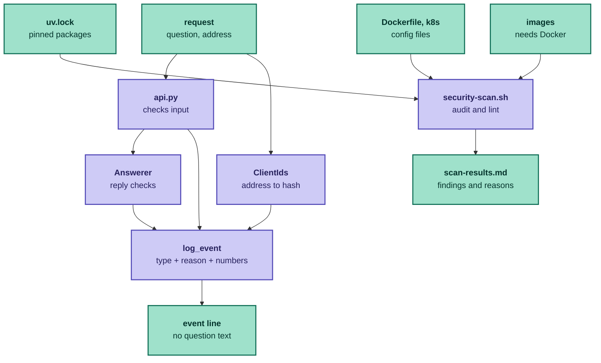

# Issue #12: Security checks

What was built: security-event logging that carries no sensitive data, a scan script (dependencies, our code, Dockerfile and Kubernetes files, and images when Docker exists), recorded results, and a review of every item on the project security checklist.

Related: [glossary](glossary.md), [Python for Node/TS developers](python-for-node-devs.md), [issue #7](issue-07-http-api.md), [issue #8](issue-08-prompt-injection-defenses.md), [decisions](../decisions.md), [scan results](../security/scan-results.md), [checklist review](../security/checklist-review.md).

Note: Docker was not available, so **the container images were not scanned**. The results page has an empty table and the one command to fill it (`scripts/security-scan.sh images`).

## The big picture

**Key**

- **Teal boxes are data:** requests, log lines, reports.
- **Purple boxes are code:** programs and functions.

### What happens, step by step

**Logging path (every request)**

1. **request:** someone sends `POST /ask` with a question. The caller's address and the question arrive together.
2. **api.py checks the input:** is the body too big, valid JSON, a string, not empty, not too long? If any check fails, it rejects the request and logs why.
3. **ClientIds hides the caller:** the address becomes a short scrambled ID. The raw address is never written down.
4. **Answerer checks the reply:** the model answers. If the reply leaks the rules, or cites nothing that was really retrieved, it is withheld and logged. If the model call fails, only the error type is logged.
5. **log_event writes one line:** it takes an event name, a reason and numbers. It has no place to put the question text, so none can leak.
6. **event line:** the result is a single line like `event=rate_limited client=ab12cd34ef56 retry_after=5`. Safe to read, share or ship to a log tool.

**Scanning path (run on demand)**

7. **Inputs:** `uv.lock` lists the exact packages. The Dockerfile and k8s files describe how it runs. The images are the built containers (not scanned yet, needs Docker).
8. **security-scan.sh:** runs the scanners. `pip-audit` checks packages against known bugs, `bandit` checks our code, `checkov` checks the config files, `trivy` checks images.
9. **scan-results.md:** the findings are written down. Each one is fixed or kept with a reason. A new finding makes the script fail.

## Files and purpose

- `src/attack_graph/security_log.py`: `log_event`, `ClientIds`, `configure_logging`.
- `src/attack_graph/api.py`: logs rate-limit hits, rejected input, crashes.
- `src/attack_graph/answer.py`: logs model failures and withheld replies.
- `src/attack_graph/cli.py`: turns logging on for `serve` and turns the address-printing access log off.
- `src/attack_graph/config.py`: `ATTACK_GRAPH_LOCAL_URL` is now checked like the other addresses.
- `tests/test_security_events.py`: events appear, and secrets never do.
- `scripts/security-scan.sh`: the repeatable scans.
- `docs/security/scan-results.md`: what the scans found and why each kept finding is accepted.
- `docs/security/checklist-review.md`: every checklist item as pass, fail or n/a, with evidence.
- `docs/decisions.md`: the logging policy and the scan choices.

## Code tour

### security_log.py

- `log_event("rate_limited", client=..., retry_after=5)` writes `event=rate_limited client=... retry_after=5`. Values lose their whitespace so one value cannot fake a second field.
- `ClientIds.of(address)` is an HMAC with a random key made at startup. The key is never saved.
- `configure_logging()` adds a stderr handler once. Python hides INFO logs unless something configures them.

### api.py and answer.py

- Each place that rejects or withholds something calls `log_event` with a reason and a length, never the text itself.
- Crashes log only the exception's class name: the message could hold a key or the question.

### tests/test_security_events.py

- The tests plant a secret-looking question, key and exception message, trigger each event, and assert the log contains the event but none of the secrets (`caplog` captures log output).

### scripts/security-scan.sh

- `pip-audit` reads the packages from `uv.lock`; `bandit` reads our Python; `checkov` reads the Dockerfile and Kubernetes files. `images` mode builds both images and runs `trivy`.
- Accepted findings are listed at the top of the script with a reason, so a new finding still fails the run.

## What to try

1. **Run the scans:** `scripts/security-scan.sh` (needs internet, no Docker).
2. **Image scan:** with Docker and trivy installed, `scripts/security-scan.sh images`, then fill in the table in `scan-results.md`.
3. **See an event:** run `uv run attack-graph serve`, send `curl -s localhost:8000/ask -d 'not json'`, and read the `input_rejected` line on stderr.
