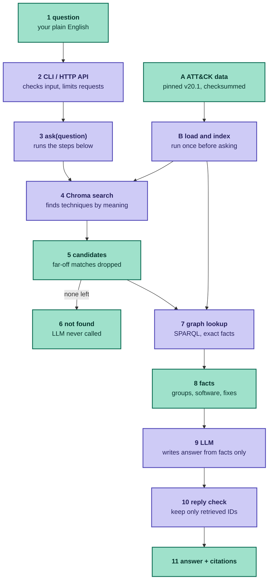

# Issue #13: Documentation

What was built: the README, an operations guide, a final pass on the decisions log, and the ATT&CK credit. No code changed.

Related: [glossary](glossary.md), [Python for Node/TS developers](python-for-node-devs.md), [README](../../README.md), [operations guide](../operations.md), [decisions](../decisions.md), [issue #12](issue-12-security-checks.md).

Note: Docker, kind, kubectl and an API key were not available, so the README demo uses the offline answerer and the guides mark everything unrun as unverified.

## New ideas in plain English

- **Verification status:** a table saying what was really run and what was only written. It stops the docs claiming more than is true.
- **Smoke test:** one script that starts the thing and checks it basically works. `compose-smoke.sh` and `k8s-smoke.sh` are the ones still to run.
- **Offline answerer:** a stand-in that restates one fact. Good for demos with no key; says nothing about real answer quality.
- **Licence notice:** MITRE lets you use ATT&CK if you keep their copyright line and licence with any copy. The README does.
- **Accepted vs open:** an accepted finding has a written reason; an open gap is a known weakness nobody has fixed yet.

## The big picture: how the whole project answers a question

This is the diagram from the README. Numbers match the steps below it.

**Key**

- **Teal boxes are data:** text and facts moving through.
- **Purple boxes are code:** the parts that do work.

## The steps

1. **Question:** you type something like "how do attackers get in through email?".
2. **CLI / HTTP API:** the front door. Rejects empty or too-long questions, rate-limits, and always replies in the same `{success, data, error}` shape.
3. **ask(question):** the one function that runs steps 4 to 11. The CLI and API both call it.
4. **Chroma search:** your question is embedded (turned into numbers for its meaning) and Chroma returns the techniques with the closest numbers.
5. **Candidates:** the closest techniques. Anything farther than cosine distance 0.75 is dropped.
6. **Not found:** nothing left means we stop and say so. The LLM is never called.
7. **Graph lookup:** a SPARQL query fetches exact facts for each candidate.
8. **Facts:** which groups use it, which software, which mitigations, as plain text.
9. **LLM:** gets the question and only these facts, and writes a short answer.
10. **Reply check:** keep only technique IDs we really retrieved. A reply with none, or one leaking the rules, becomes "not found".
11. **Answer + citations:** what you see.

**Setup, once:** **A** is MITRE's data file. **B** `load` builds the graph (feeds 7) and `index` embeds every technique into Chroma (feeds 4).

## Key terms

- **ATT&CK:** MITRE's public catalog of attacker behavior.
- **Technique:** one attacker method with an ID, like `T1566` (Phishing).
- **Vector:** a list of numbers standing for a text's meaning.
- **Embed:** turn text into a vector. Similar meanings give similar numbers.
- **MiniLM (`all-MiniLM-L6-v2`):** the small model that makes the embeddings. Runs on your CPU, no key, ~80 MB download once.
- **Chroma:** a vector database. Stores vectors and finds the closest ones to your question.
- **Cosine distance:** how far apart two meanings are. 0 is identical; our cutoff is 0.75.
- **Knowledge graph / RDF:** facts stored as links (`APT29 uses T1566`).
- **SPARQL:** the query language for those links, like SQL for a graph.
- **Oxigraph:** the SPARQL server used in Docker and Kubernetes.
- **LLM:** the AI that writes the answer: Claude, a local model, or `offline`.
- **RAG:** retrieve facts first, then let the LLM write only from them.
- **Citation:** a technique ID we really retrieved, so you can check the claim.
- **Prompt injection:** text that tries to make the AI ignore its rules. We lower the risk, not remove it.

## Files and purpose

- `README.md`: pitch, two-minute explanation, architecture diagram, demo, quick start, verification status, future improvements, ATT&CK credit.
- `docs/operations.md`: verification table, run locally, Compose, Kubernetes, configuration table, troubleshooting, scans.
- `docs/decisions.md`: stale entries updated; new entry for the documentation choices.
- `CLAUDE.md`: current stage and the README note.
- `docs/learning/issue-13-documentation.md`: this page.

## Doc tour

### README.md

- The demo output is copy-pasted from real runs on the fixture. If a command changes, run it again.
- The credit section quotes MITRE's notice from their Terms of Use page. The year changes, so re-check it.
- It says the repo has no licence for its own code yet. That is your choice to make.

### docs/operations.md

- Start with the verification table: it lists the exact command that proves each unrun piece.
- The troubleshooting table is keyed by the message you will see, so search for it.

## What to try

1. **Close the gaps:** run `scripts/compose-smoke.sh`, `scripts/k8s-smoke.sh`, `scripts/security-scan.sh images`, then `uv run attack-graph eval` with a key.
2. **Update the tables:** after each run, change the status in `docs/operations.md`, the README and `docs/security/scan-results.md`.
3. **Pick a licence** for your own code and add a `LICENSE` file.
