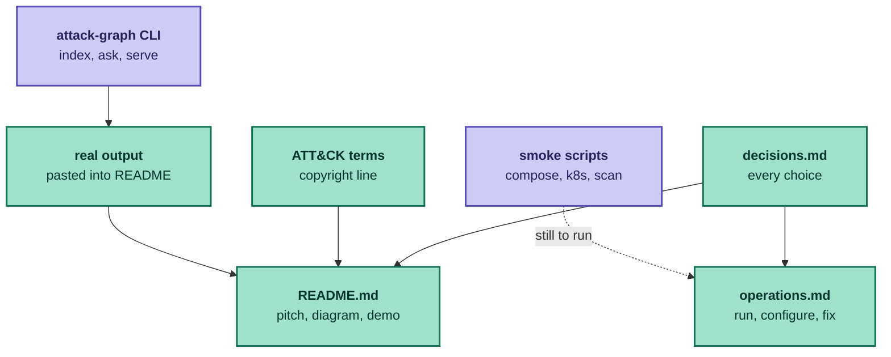

# Issue #13: Documentation

What was built: the README, an operations guide, a final pass on the decisions log, and the ATT&CK credit. No code changed.

Related: [glossary](glossary.md), [Python for Node/TS developers](python-for-node-devs.md), [README](../../README.md), [operations guide](../operations.md), [decisions](../decisions.md), [issue #12](issue-12-security-checks.md).

Note: Docker, kind, kubectl and an API key were not available, so the README demo uses the offline answerer and the guides mark everything unrun as unverified.

## New ideas in plain English

- **Verification status:** a table saying what was really run and what was only written. It stops the docs claiming more than is true.
- **Smoke test:** one script that starts the thing and checks it basically works. `compose-smoke.sh` and `k8s-smoke.sh` are the ones still to run.
- **Offline answerer:** a stand-in that restates one fact. Good for demos with no key; says nothing about real answer quality.
- **Licence notice:** MITRE lets you use ATT&CK if you keep their copyright line and licence with any copy. The README does.
- **Accepted vs open:** an accepted finding has a written reason; an open gap is a known weakness nobody has fixed yet.

## The big picture

**Key**

- **Teal boxes are data:** the docs and the facts they report.
- **Purple boxes are code:** the commands and scripts that produce or check them.

## Files and purpose

- `README.md`: pitch, two-minute explanation, architecture diagram, demo, quick start, verification status, future improvements, ATT&CK credit.
- `docs/operations.md`: verification table, run locally, Compose, Kubernetes, configuration table, troubleshooting, scans.
- `docs/decisions.md`: stale entries updated; new entry for the documentation choices.
- `CLAUDE.md`: current stage and the README note.
- `docs/learning/issue-13-documentation.md`: this page.

## Doc tour

### README.md

- The demo output is copy-pasted from real runs on the fixture. If a command changes, run it again.
- The credit section quotes MITRE's notice from their Terms of Use page. The year changes, so re-check it.
- It says the repo has no licence for its own code yet. That is your choice to make.

### docs/operations.md

- Start with the verification table: it lists the exact command that proves each unrun piece.
- The troubleshooting table is keyed by the message you will see, so search for it.

## What to try

1. **Close the gaps:** run `scripts/compose-smoke.sh`, `scripts/k8s-smoke.sh`, `scripts/security-scan.sh images`, then `uv run attack-graph eval` with a key.
2. **Update the tables:** after each run, change the status in `docs/operations.md`, the README and `docs/security/scan-results.md`.
3. **Pick a licence** for your own code and add a `LICENSE` file.
