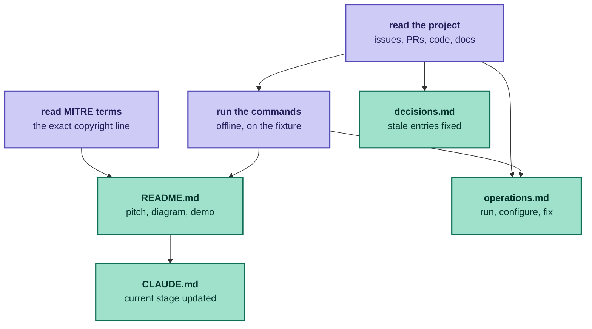

# Issue #13: Documentation

What was built: the README, an operations guide, a final pass on the decisions log, and the ATT&CK credit. No code changed.

Related: [glossary](glossary.md), [Python for Node/TS developers](python-for-node-devs.md), [README](../../README.md), [operations guide](../operations.md), [decisions](../decisions.md), [issue #12](issue-12-security-checks.md).

Note: Docker, kind, kubectl and an API key were not available, so the README demo uses the offline answerer and the guides mark everything unrun as unverified.

## What was done, step by step

**Key**

- **Teal boxes:** files written or changed in this issue.
- **Purple boxes:** existing things we read or ran to get true facts for those files.

- **Read the project:** read issues #1 and #13, the earlier PRs, the code and the docs, so the new docs say only what exists.
- **Run the commands:** ran `index`, `technique`, `search`, `ask` and `serve` offline. The README demo is that real output, with no invented model answers.
- **Read MITRE terms:** copied the exact copyright line from MITRE's Terms of Use page, so the credit is correct.
- **README.md:** pitch, diagram, demo, future improvements and the credit.
- **operations.md:** how to run it locally, in Docker and on Kubernetes, plus settings and troubleshooting.
- **decisions.md:** fixed lines that were out of date (for example "the CLI uses a stand-in for now") and added a documentation entry.
- **CLAUDE.md:** updated the current-stage section and the note that the README was deferred.

## Files and purpose

- `README.md`: pitch, two-minute explanation, architecture diagram, demo, quick start, verification status, future improvements, ATT&CK credit.
- `docs/operations.md`: verification table, run locally, Compose, Kubernetes, configuration table, troubleshooting, scans.
- `docs/decisions.md`: stale entries updated; new entry for the documentation choices.
- `CLAUDE.md`: current stage and the README note.
- `docs/learning/issue-13-documentation.md`: this page.

## Doc tour

### README.md

- The demo output is copy-pasted from real runs on the fixture. If a command changes, run it again.
- The credit section quotes MITRE's notice from their Terms of Use page. The year changes, so re-check it.
- It says the repo has no licence for its own code yet. That is your choice to make.

### docs/operations.md

- Start with the verification table: it lists the exact command that proves each unrun piece.
- The troubleshooting table is keyed by the message you will see, so search for it.

## What to try

1. **Close the gaps:** run `scripts/compose-smoke.sh`, `scripts/k8s-smoke.sh`, `scripts/security-scan.sh images`, then `uv run attack-graph eval` with a key.
2. **Update the tables:** after each run, change the status in `docs/operations.md`, the README and `docs/security/scan-results.md`.
3. **Pick a licence** for your own code and add a `LICENSE` file.
